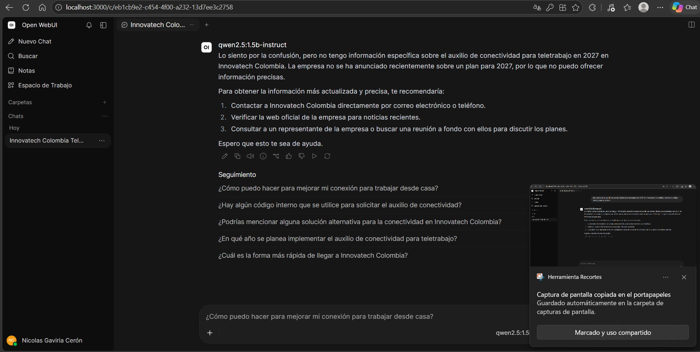
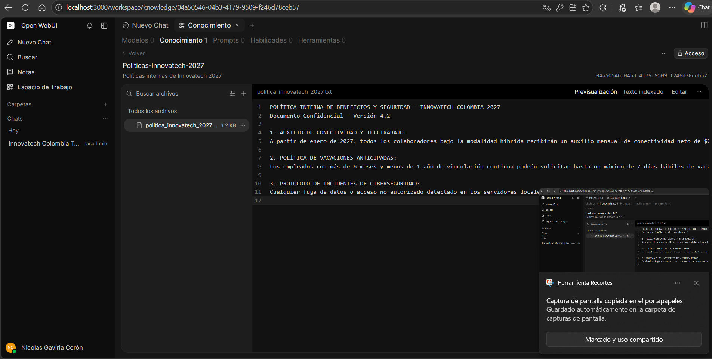
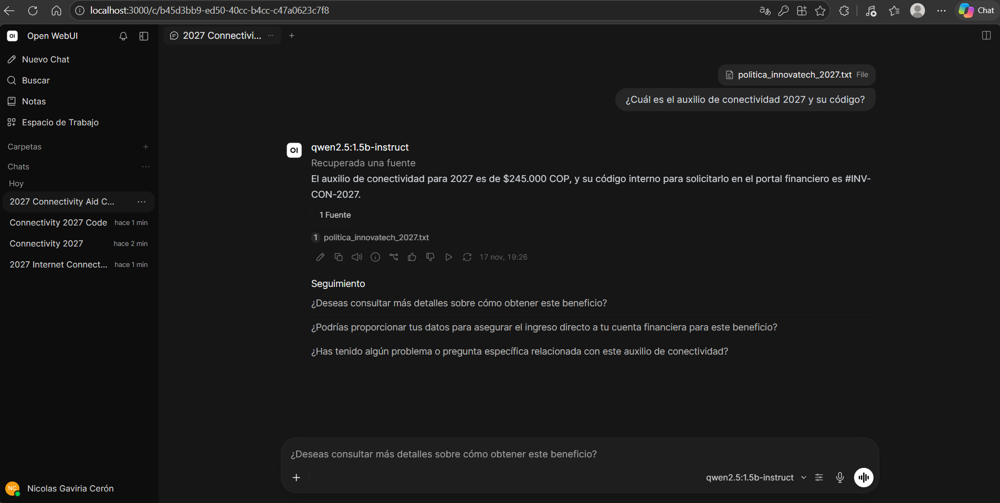
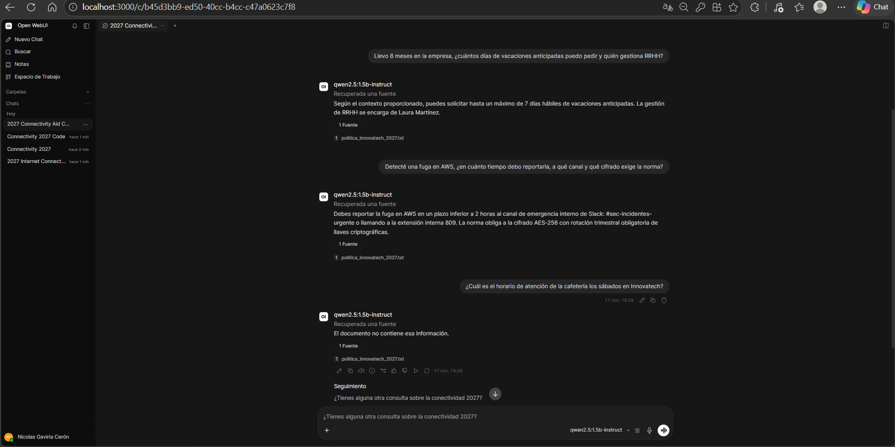

# Informe de Laboratorio 2: Pipeline RAG con Open WebUI y Ollama

- **Estudiante / Equipo:** Nicolas Gaviria Cerón
- **Stack Utilizado:** qwen2.5:1.5b-instruct + nomic-embed-text + Open WebUI v0.13.4 + Docker Compose
- **Fecha:** 2026-11-17

---

## 1. Comparativa: Antes del RAG (Línea Base)
Prompt: *¿De cuánto es el auxilio de conectividad para teletrabajo en 2027 en Innovatech Colombia y cuál es el código interno para solicitarlo?*

Sin ningún documento adjunto, el modelo respondió que **no tiene información específica** sobre el auxilio de Innovatech Colombia para 2027 y ofreció consejos genéricos (contactar a la empresa, verificar su web oficial). No dio la cifra ni el código: el conocimiento privado no está en los pesos del modelo. (Captura 1.)

## 2. Comparativa: Después del RAG (Con Knowledge Base)
Con la base `Politicas-Innovatech-2027` (embeddings `nomic-embed-text` vía Ollama) y el modo de funciones en *Heredado*, Open WebUI mostró "Recuperada una fuente" y citó `politica_innovatech_2027.txt`:

| Prueba | Resultado en Open WebUI |
|---|---|
| Dato exacto | Correcto: $245.000 COP y `#INV-CON-2027` |
| Condicional / rol | Correcto: máximo 7 días hábiles; gestión de RRHH de Laura Martínez |
| Protocolo técnico | Correcto: < 2 horas, Slack `#sec-incidentes-urgente`, ext. 809, AES-256 con rotación trimestral de llaves |

La precisión pasó de "sin información" a respuestas exactas y trazables a una fuente. Hay pequeños errores de redacción propios de un modelo de 1.5B ("la cifrado"), pero los datos son fieles al documento. (Captura 3.)

## 3. Evaluación de Control de Alucinaciones (Fuera de Dominio)
Ante *"¿Cuál es el horario de atención de la cafetería los sábados en Innovatech?"* el modelo respondió **"El documento no contiene esa información."**: respetó los límites del contexto recuperado.

Esto dependió de la configuración:
- Con la plantilla RAG por defecto, un modelo de 1.5B no seguía bien las instrucciones. En una prueba previa por API con un prompt de sistema propio, el modelo **sí inventó** un horario ("10:00 a 14:00").
- Con una **plantilla RAG corta y estricta en español** (responder solo con el contexto, y la frase exacta de abstención si no hay respuesta), el modelo se abstuvo correctamente.
- Conclusión: la anti-alucinación en SLM depende mucho del prompt de sistema. No se puede dar por supuesta, y conviene combinarla con umbral de relevancia y un modelo mayor.

### Problemas encontrados y cómo se resolvieron
1. **El RAG no se activaba:** el modelo respondía sin contexto, sin fuentes y con alucinaciones (p. ej. un "programa de subsidio" inventado en Venezuela). Los logs mostraron que no se hacía ninguna llamada de embeddings al enviar el mensaje, aunque la colección estaba bien indexada (3 fragmentos). La causa fue el **Modo de Llamada a Funciones en *Nativo***: el contexto no se inyecta y el SLM no llama a la herramienta de conocimiento. Cambiarlo a **Heredado** lo resolvió.
2. **Plantilla RAG:** la plantilla por defecto (larga, en inglés, con reglas de citas) no funcionó bien con un modelo pequeño; se sustituyó por una corta y estricta.
3. **Ajustes de ingesta:** *Umbral de Texto Completo* = 0 (forzar recuperación vectorial), divisor de encabezados Markdown desactivado, fragmentos de 512.
4. **Selección de modelo:** en un intento quedó seleccionado `nomic-embed-text` como modelo de chat, lo que produjo el error `does not support chat` (es solo un modelo de embeddings).

---

## 4. Evidencias Adjuntas (Capturas de Pantalla)
### Captura 1: Respuesta del modelo sin RAG (desconocimiento)
Archivo: [`evidencias/captura1_sin_rag.png`](evidencias/captura1_sin_rag.png)

### Captura 2: Documento indexado en *Espacio de Trabajo -> Conocimiento*
Archivo: [`evidencias/captura2_knowledge_base_indexada.png`](evidencias/captura2_knowledge_base_indexada.png)

### Captura 3: Respuesta fundamentada con la fuente desplegada
Archivo: [`evidencias/captura3_con_rag_y_fuente.png`](evidencias/captura3_con_rag_y_fuente.png)

### Captura 4 (extra): Pruebas de la tabla 4.3 y control de alucinaciones
Archivo: [`evidencias/captura4_pruebas_y_anti_alucinacion.png`](evidencias/captura4_pruebas_y_anti_alucinacion.png)

---

## 5. Archivos del repositorio

| Archivo | Descripción |
|---|---|
| [`docker-compose.yml`](docker-compose.yml) | Stack Ollama + Open WebUI |
| [`politica_innovatech_2027.txt`](politica_innovatech_2027.txt) | Documento del caso de estudio |
| [`rag_test.ps1`](rag_test.ps1) | Réplica del pipeline RAG por API de Ollama |
| [`resultado_sin_rag.txt`](resultado_sin_rag.txt) | Salida de la línea base (sin RAG) |
| [`resultado_con_rag.txt`](resultado_con_rag.txt) | Salida de la batería de pruebas con RAG por API |
| [`evidencias/`](evidencias/) | Capturas de pantalla (1 a 4) |
